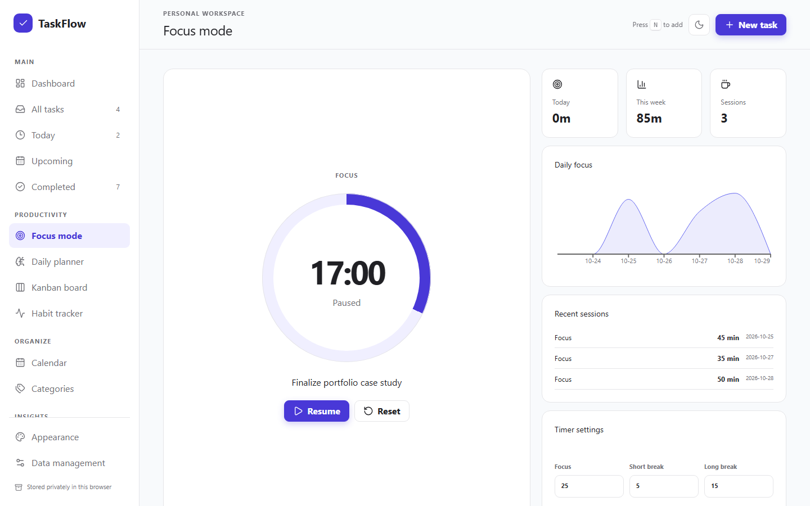
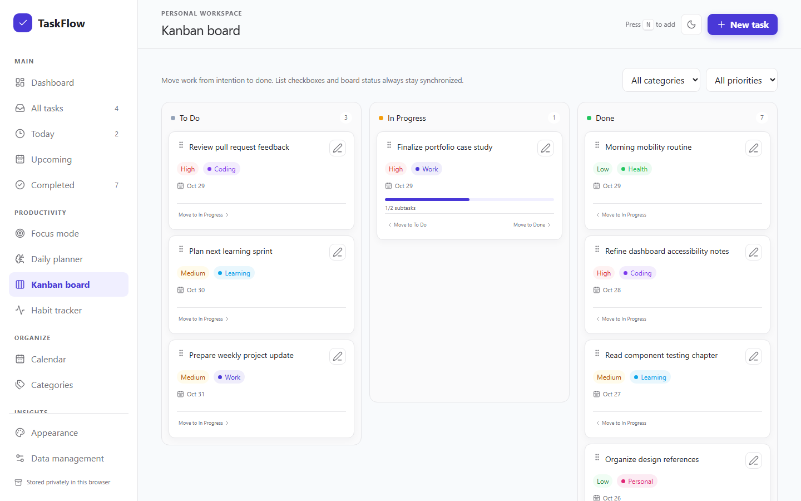
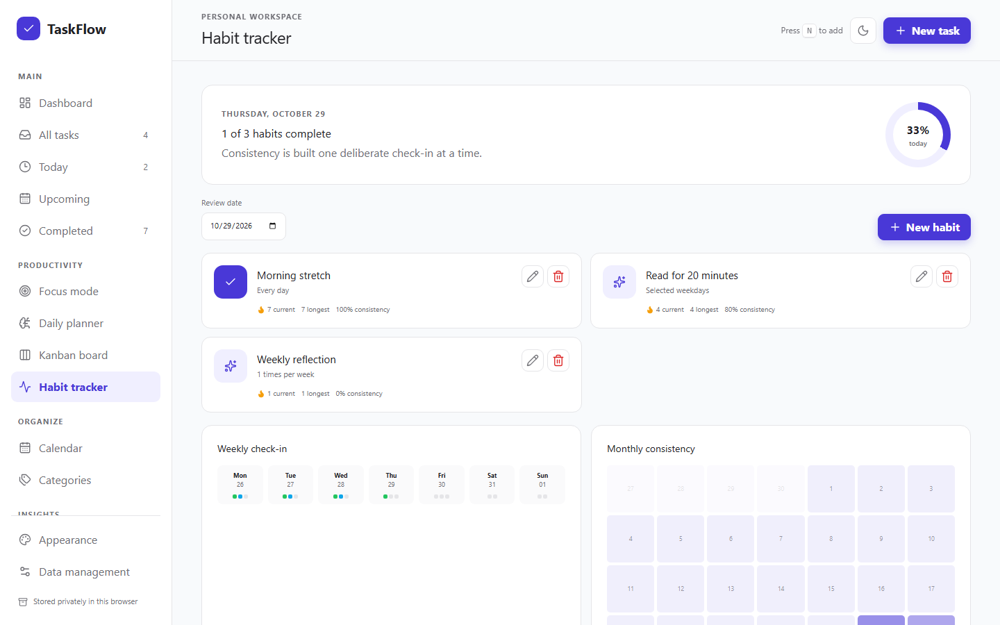
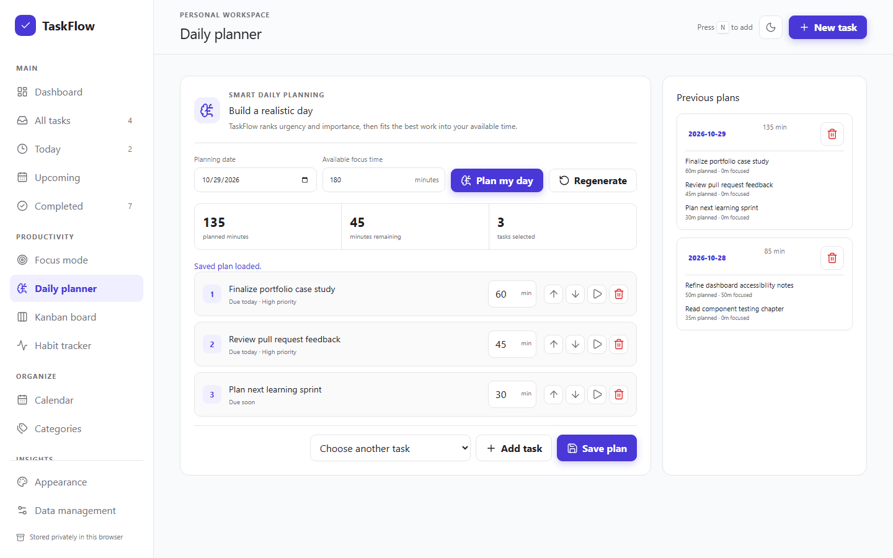
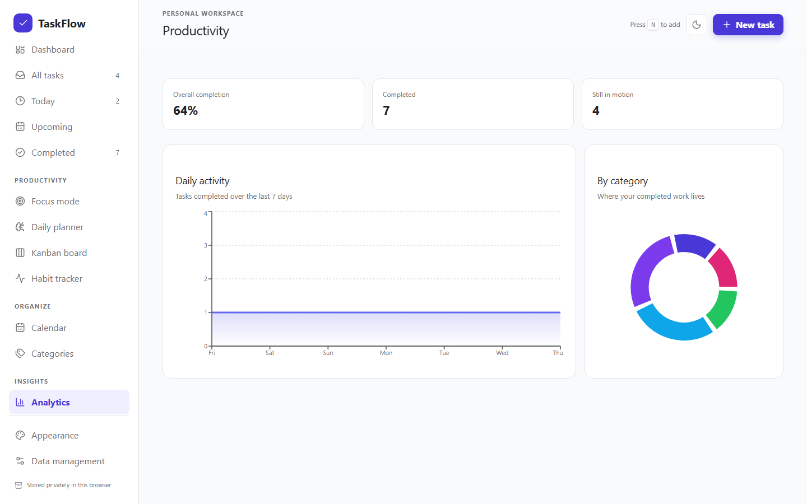

# TaskFlow

TaskFlow brings task management, focus sessions, habit tracking, and rule-based daily planning into one personal productivity workspace. It runs entirely in the browser and keeps the user's workspace in LocalStorage.

[Live demo](https://taskflow-benz.netlify.app) · [GitHub repository](https://github.com/benzbago/taskflow)

  


_The dashboard and gallery below show the real application populated with demonstration data in an isolated browser session._

## Product tour

| Focus mode                                                                                                         | Kanban board                                                                                                  |
| ------------------------------------------------------------------------------------------------------------------ | ------------------------------------------------------------------------------------------------------------- |
|                     |  |
| Habit tracker                                                                                                      | Daily planner                                                                                                 |
|  |            |
| Analytics                                                                                                          |                                                                                                               |
|                  |                                                                                                               |

## Features

### Task management

- Create, edit, duplicate, delete, pin, and complete tasks.
- Add priorities, due dates and times, categories, notes, time estimates, and subtasks.
- Generate the next daily or weekly recurring task after completing the current one.
- Search tasks, filter by status, priority, or category, and sort by due date, priority, creation date, or status.

### Productivity tools

- Run configurable Pomodoro focus, short-break, and long-break sessions, with optional task linking and timer recovery after reload.
- Move tasks through synchronized To Do, In Progress, and Done Kanban columns using drag and drop or accessible move controls.
- Track daily, selected-weekday, or weekly-frequency habits with streaks, weekly check-ins, and a monthly heatmap.
- Build and save a daily plan using deterministic rules based on urgency, priority, estimated effort, and available time. Every suggestion includes its reasons.
- Review work in calendar and analytics views, including seven-day completion activity and completed tasks by category.

### Personalization and data

- Choose a light, dark, or system theme and an optional compact layout.
- Keep tasks, settings, focus history, habits, and plans in browser LocalStorage.
- Export and import versioned JSON backups.
- Validate imports before replacement, preserve the current workspace for recovery, and fall back to valid recovery data when the primary record is damaged.

## Engineering highlights

TaskFlow separates navigation, shared task UI, domain pages, persistence, and calculation logic so each area has a clear responsibility. The application state lives in a context backed by a reducer, giving task, habit, focus, planning, and settings updates one predictable path.

The stored document uses an explicit schema version. Migration code converts version 1 data to version 2, while validation and recovery safeguards reduce the chance that a malformed import or damaged LocalStorage record replaces a valid workspace. React error boundaries contain failures at both application and feature-page levels without clearing stored data.

Quality checks cover reducer behavior, domain utilities, component interactions, accessibility states, persistence failure paths, and critical Chromium workflows. Tiered coverage thresholds place stricter requirements on business logic and the Pomodoro hook than on the UI as a whole. GitHub Actions runs linting, formatting, coverage, a production build, and the Playwright suite on pull requests and pushes to `master`.

Accessibility work includes semantic active-page states, modal focus containment and restoration, validation relationships, keyboard-operable Kanban controls, status announcements, and reduced-motion support. Netlify builds the Vite application from the repository and applies an SPA fallback through `netlify.toml`.

## Technology stack

| Technology                       | Purpose                                                        |
| -------------------------------- | -------------------------------------------------------------- |
| React 19                         | Component rendering and application composition                |
| Vite 8                           | Local development, production builds, and test configuration   |
| JavaScript                       | Application and domain logic                                   |
| Tailwind CSS 4                   | Utility generation alongside the project design system         |
| Motion                           | Page, list, and dialog transitions with reduced-motion support |
| Recharts                         | Focus and productivity charts                                  |
| Lucide React                     | Interface icons                                                |
| LocalStorage                     | Browser-local persistence for the versioned workspace          |
| Vitest and React Testing Library | Unit, component, reducer, and integration tests                |
| Playwright                       | Chromium end-to-end workflows                                  |
| ESLint and Prettier              | Static analysis and consistent formatting                      |
| GitHub Actions                   | Automated verification in CI                                   |
| Netlify                          | Production build and static hosting                            |

## Run locally

TaskFlow uses Node.js 24 in CI. Use the same major version locally for the closest match to the verified environment.

```bash
git clone https://github.com/benzbago/taskflow.git
cd taskflow
npm ci
npm run dev
```

Vite prints the local development URL after startup.

Create and inspect a production build with:

```bash
npm run build
npm run preview
```

## Testing and quality checks

The current verified baseline is 94 Vitest unit/component tests and 10 Playwright browser tests, for 104 automated tests in total.

Install Playwright's Chromium browser before the first end-to-end run:

```bash
npx playwright install chromium
```

On a Linux machine that also needs the browser's system dependencies, run `npx playwright install --with-deps chromium` instead.

```bash
npm run lint           # ESLint
npm run format:check   # Prettier verification
npm test -- --run      # Unit and component suite once
npm run test:coverage  # Coverage reports and thresholds
npm run test:e2e       # Production build plus Chromium workflows
npm run build          # Production bundle
```

Vitest writes text, HTML, JSON, and JSON-summary reports to `coverage/`. Global minimums are 68% statements, 66% branches, 54% functions, and 69% lines. Critical context and domain utility files have higher grouped thresholds, and the context and Pomodoro hook also have file-specific limits.

The Playwright suite verifies task persistence, Kanban synchronization, Pomodoro recovery, habits, daily plans, import/export safety, keyboard behavior, and navigation semantics. CI uploads coverage and available Playwright diagnostics as 14-day workflow artifacts.

## Project structure

```text
taskflow/
├── src/
│   ├── components/       # App shell, navigation, shared UI, and task controls
│   ├── pages/            # Dashboard, productivity tools, and settings views
│   ├── context/          # Reducer-backed state and action API
│   ├── hooks/            # Pomodoro state and timer recovery
│   ├── utils/            # Domain rules, dates, migrations, and persistence
│   └── test/             # Shared Vitest setup
├── e2e/                  # Playwright workflows and local preview runner
├── docs/                 # Portfolio copy, screenshots, and design records
└── .github/workflows/    # Continuous integration
```

Pages compose domain-specific views, while reusable interaction patterns stay in components. Context coordinates state transitions. Hooks own stateful behavior that benefits from a focused interface, and utilities hold calculations and persistence rules that can be tested without rendering the UI.

## Data model and limitations

TaskFlow stores a version 2 document under the legacy-compatible key `taskflow:v1`. The data belongs to the current browser profile and device.

- There is no account system or automatic cross-device synchronization.
- Clearing browser storage can remove the workspace.
- JSON exports are the portable backup mechanism, so users should export them regularly if the records matter.
- Browser automation currently targets Chromium only.
- TaskFlow has no backend, shared workspaces, notifications, or AI service.

## Repository presentation recommendations

These settings require a repository owner to update them manually on GitHub:

| Setting        | Suggested value                                                                                                                                                                                 |
| -------------- | ----------------------------------------------------------------------------------------------------------------------------------------------------------------------------------------------- |
| Description    | `Personal productivity workspace for tasks, Pomodoro focus, Kanban workflows, habits, daily planning, and analytics.`                                                                           |
| Homepage       | `https://taskflow-benz.netlify.app`                                                                                                                                                             |
| Topics         | `react`, `vite`, `javascript`, `tailwindcss`, `productivity`, `task-manager`, `pomodoro`, `kanban`, `habit-tracker`, `localstorage`, `vitest`, `playwright`                                     |
| Social preview | Use `docs/screenshots/taskflow-dashboard.png`. Crop or resize it to GitHub's recommended social-preview dimensions in an image editor before upload rather than changing the source screenshot. |

Open the repository's **About** settings to add the description, homepage, and topics. Open **Settings → General → Social preview** to upload the dashboard image.

## Credits

TaskFlow is built with the open-source tools listed in the technology table. Interface icons come from [Lucide](https://lucide.dev/), charts use [Recharts](https://recharts.github.io/), and animations use [Motion](https://motion.dev/). No tutorial foundation or third-party application template is identified in the repository.
