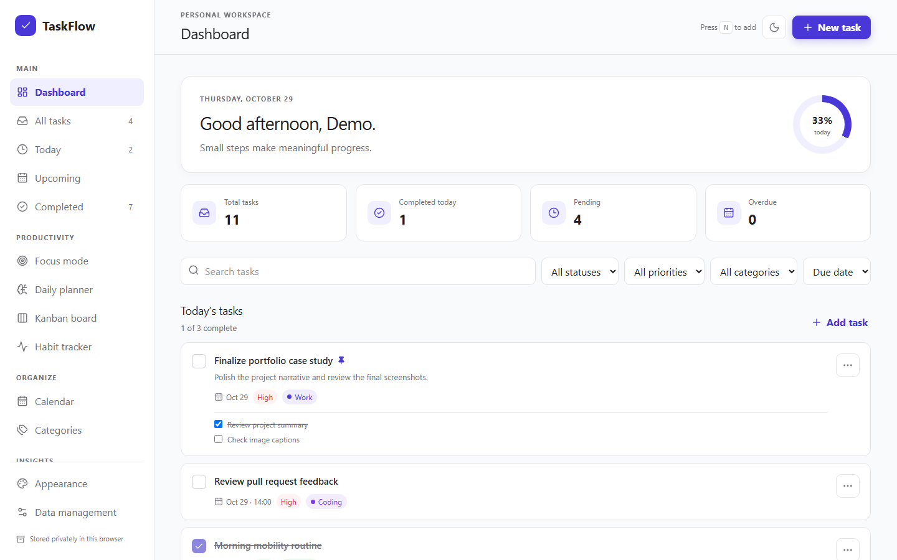

# TaskFlow

A browser-based productivity workspace that combines task management, Pomodoro focus sessions, Kanban workflows, habit tracking, daily planning, and analytics.

[View the live application](https://taskflow-benz.netlify.app) · [Browse the source](https://github.com/benzbago/taskflow)

_This screenshot shows the real application populated with sample data in an isolated browser session._

## Project overview

I built TaskFlow as a personal productivity application for planning work and following through on it without moving between several tools. Tasks form the shared foundation: they appear on the dashboard, move through the Kanban board, feed the daily planner, and can be linked to focus sessions. Habits and analytics add a longer view of consistency.

The application runs entirely in the browser. That keeps setup simple and personal data local, but it also shaped the engineering work. Persistence, migrations, import validation, and recovery handling had to be dependable because there is no server copy to fall back on.

## Main features

- Task creation and editing with priorities, categories, dates, times, notes, estimates, subtasks, pinning, and recurrence.
- Search, filtering, sorting, completion views, and a calendar.
- Configurable Pomodoro sessions with task linking, pause and resume controls, history, and reload recovery.
- A Kanban board synchronized with the same task state used throughout the application.
- Schedule-aware habits with streak calculations, weekly check-ins, and a monthly consistency heatmap.
- A deterministic daily planner that fits ranked tasks into a time budget and explains each suggestion.
- Completion and category analytics built from local task history.
- Light, dark, and system themes, plus a compact display option.
- Validated JSON backups with versioned migrations and recovery safeguards.

## Technology

I used React 19 and JavaScript for the interface and application logic, with Vite 8 for development and production builds. Tailwind CSS supports styling, Motion handles interface transitions, Lucide supplies icons, and Recharts renders productivity data.

The test setup combines Vitest, React Testing Library, and Playwright. ESLint and Prettier run alongside the test and build commands in GitHub Actions. Netlify hosts the production build and applies the single-page application redirect.

## Engineering challenges and solutions

### Keeping one task model consistent across several tools

The dashboard, lists, calendar, Kanban board, planner, and focus mode all read from the same task state. I centralized state transitions in a context and reducer, then kept filtering, sorting, recurrence, metrics, and planning rules in focused utility modules. A Kanban move therefore updates the task everywhere instead of maintaining a separate board copy.

### Making browser-only storage safer

LocalStorage is convenient, but malformed records and incompatible backups can leave an application unusable. TaskFlow stores an explicit schema version, migrates version 1 records, validates imported structures, and preserves recoverable data before replacing a workspace. Storage failures remain visible to the user rather than silently suggesting that a change was saved.

### Recovering time-based focus sessions

A timer based only on component intervals drifts or resets when the page reloads. TaskFlow reconstructs the remaining time from persisted timestamps, elapsed time, and the configured duration. Completed sessions are deduplicated before they enter focus history.

### Producing useful plans without hiding the rules

The daily planner uses deterministic scoring instead of an external AI service. It considers due dates, priority, previous plans, estimates, and the available time budget. Each suggested item retains human-readable reasons, so the user can understand and reorder the result.

### Testing failure paths and keyboard behavior

The current suite has 94 unit/component tests and 10 Chromium end-to-end tests. Tests cover reducer and utility behavior, migrations, storage failures, modal focus management, accessible validation, keyboard Kanban controls, backup replacement, timer recovery, and persistence across reloads. The grouped critical-file thresholds are stricter than the global minimums, and the context and Pomodoro hook also have file-specific limits.

## Development context

TaskFlow is an independently directed personal project, not a team or client engagement. The repository includes agent-assisted design and implementation plans used to structure parts of the work. I remained responsible for the requirements, technical decisions, verification, and final review. The repository does not identify a tutorial or third-party starter application beyond the libraries in `package.json`.

## Resume-ready bullets

- Built a React productivity workspace combining task management, Pomodoro sessions, synchronized Kanban workflows, scheduled habits, rule-based daily planning, calendar views, and analytics.
- Designed reducer-based state management with versioned LocalStorage migrations, structural backup validation, recovery copies, and visible persistence-failure handling.
- Implemented timestamp-based focus-session recovery and deterministic planning rules that explain why each task was selected.
- Added 104 automated tests with Vitest, React Testing Library, and Playwright, including accessibility, persistence, import/export, and Chromium workflow coverage.
- Set up ESLint, Prettier, tiered coverage thresholds, GitHub Actions verification, and Netlify deployment for a repeatable release process.
